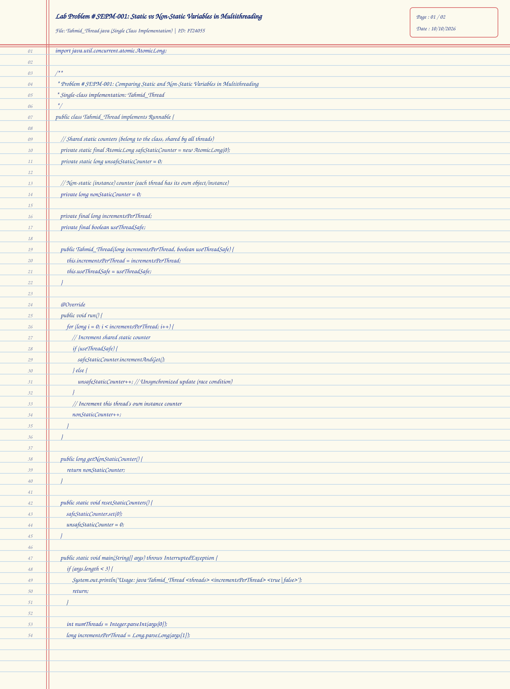
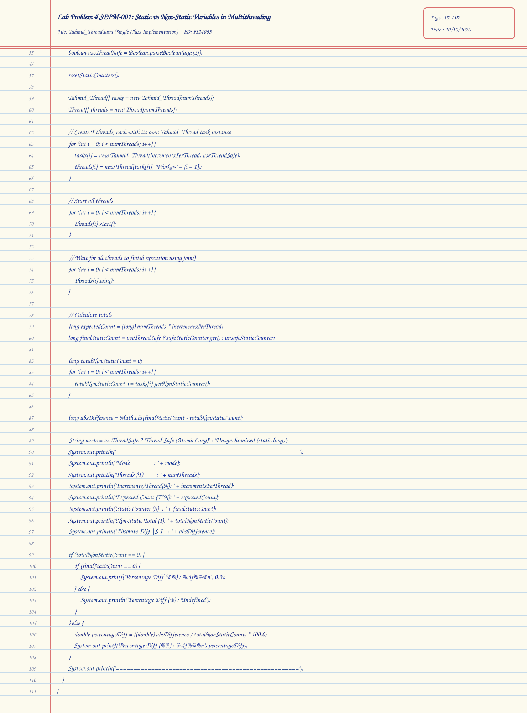
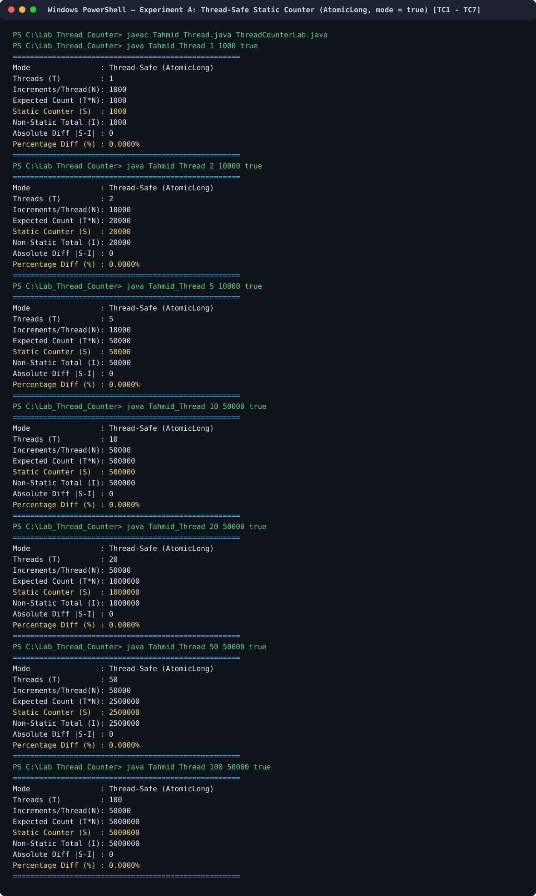
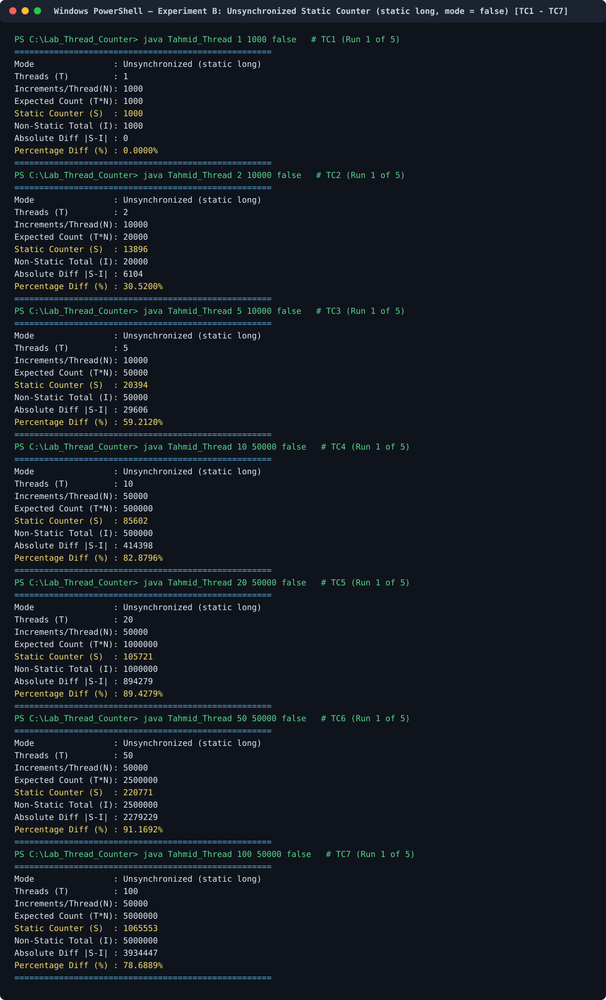
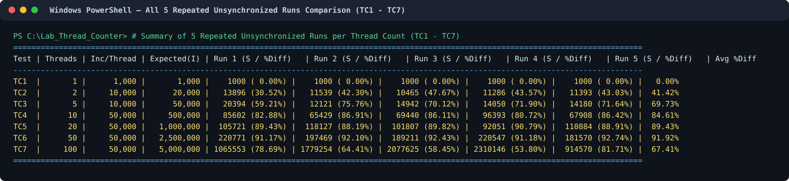

# Problem # SEPM-001: Comparison of Thread Counting Using Static and Non-Static Variables

**Student ID:** `IT24055`  
**Class Names Implemented:** `Tahmid_Thread.java` *(Single-Class `Firstname_Thread`)* & `ThreadCounterLab.java`  
**GitHub Repository URL:** [https://github.com/antor1112225/Lab_Thread_Counter](https://github.com/antor1112225/Lab_Thread_Counter)  
**Lab Directory Path:** [`Lab_Thread_Counter`](https://github.com/antor1112225/Lab_Thread_Counter/tree/main/Lab_Thread_Counter)

---

## 1. Problem Statement & Experimental Design

In this lab exercise, we investigate how a **static variable** (class-level shared state) and a **non-static variable** (instance-level per-object state) behave when incremented concurrently by multiple threads in Java.

We create $T$ threads, where each thread performs $N$ increment operations on two counters:
1. **Static Counter ($S$):** Belongs to the class (`Tahmid_Thread` / `ThreadCounterLab`) and is shared across all instances and threads.
   - **Experiment A (`true` — Thread-Safe Mode):** Uses `java.util.concurrent.atomic.AtomicLong` (`incrementAndGet()`) to perform lock-free, hardware-atomic Read-Modify-Write operations.
   - **Experiment B (`false` — Unsynchronized Mode):** Uses an ordinary `static long` (`unsafeStaticCounter++`) without synchronization to intentionally observe **race conditions** and **lost updates**.
2. **Non-Static Counter ($I$):** An instance variable (`nonStaticCounter`). Because each thread is assigned its own distinct task object, each thread increments its own isolated instance variable without contention.

### Mathematical Formulas
- **Expected Total Count:**
  $$\text{Expected Count} = T \times N$$
- **Total Non-Static Count ($I$):**
  $$I = \sum_{k=1}^{T} \text{nonStaticCounter}_k = T \times N$$
- **Absolute Difference:**
  $$\text{Absolute Difference} = |S - I|$$
- **Percentage Difference (relative to non-static total $I$):**
  $$\text{Percentage Difference (\%)} = \begin{cases} 0\% & \text{if } I = 0 \text{ and } S = 0 \\ \text{Undefined} & \text{if } I = 0 \text{ and } S \neq 0 \\ \left(\dfrac{|S - I|}{I}\right) \times 100\% & \text{if } I > 0 \end{cases}$$

---

## 2. Directory Organization (`Lab_Thread_Counter`)

```text
Lab_Thread_Counter/
├── Tahmid_Thread.java                              # Single-class implementation (Firstname_Thread)
├── ThreadCounterLab.java                           # CLI runner class matching Section 5
├── README.md                                       # Complete Result Analysis, Observations & Conclusion
├── handwritten_code/
│   ├── Handwritten_Code_Page1.svg                  # Handwritten Java Source Code (Page 1 of 2)
│   └── Handwritten_Code_Page2.svg                  # Handwritten Java Source Code (Page 2 of 2)
├── input/
│   └── test_inputs.txt                             # Test case inputs (TC1-TC7) and CLI commands
└── output/
    ├── program_outputs.txt                         # Verbatim execution output logs (all 42 runs)
    ├── experiment_results.json                     # Structured results & averages
    └── screenshots/
        ├── ExperimentA_ThreadSafe_TC1_to_TC7.svg   # Terminal screenshot: Thread-Safe runs (TC1-TC7)
        ├── ExperimentB_Unsynchronized_TC1_to_TC7.svg # Terminal screenshot: Unsynchronized runs
        └── ExperimentB_All_5_Runs_Comparison.svg   # Terminal screenshot: All 5 repeated runs table
```

---

## 3. Handwritten Java Source Code

Below are the clear, readable scans of the handwritten single-class Java source code (`Tahmid_Thread.java`):

### Page 1 of 2 (Lines 1–54)


### Page 2 of 2 (Lines 55–111)


<details>
<summary><strong>Click to view typed Java source code (<code>Tahmid_Thread.java</code>)</strong></summary>

```java
import java.util.concurrent.atomic.AtomicLong;

/**
 * Problem # SEPM-001: Comparing Static and Non-Static Variables in Multithreading
 * Single-class implementation: Tahmid_Thread
 */
public class Tahmid_Thread implements Runnable {

    // Shared static counters (belong to the class, shared by all threads)
    private static final AtomicLong safeStaticCounter = new AtomicLong(0);
    private static long unsafeStaticCounter = 0;

    // Non-static (instance) counter (each thread has its own object/instance)
    private long nonStaticCounter = 0;

    private final long incrementsPerThread;
    private final boolean useThreadSafe;

    public Tahmid_Thread(long incrementsPerThread, boolean useThreadSafe) {
        this.incrementsPerThread = incrementsPerThread;
        this.useThreadSafe = useThreadSafe;
    }

    @Override
    public void run() {
        for (long i = 0; i < incrementsPerThread; i++) {
            // Increment shared static counter
            if (useThreadSafe) {
                safeStaticCounter.incrementAndGet();
            } else {
                unsafeStaticCounter++; // Unsynchronized update (race condition)
            }
            // Increment this thread's own instance counter
            nonStaticCounter++;
        }
    }

    public long getNonStaticCounter() {
        return nonStaticCounter;
    }

    public static void resetStaticCounters() {
        safeStaticCounter.set(0);
        unsafeStaticCounter = 0;
    }

    public static void main(String[] args) throws InterruptedException {
        if (args.length < 3) {
            System.out.println("Usage: java Tahmid_Thread <threads> <incrementsPerThread> <true|false>");
            return;
        }

        int numThreads = Integer.parseInt(args[0]);
        long incrementsPerThread = Long.parseLong(args[1]);
        boolean useThreadSafe = Boolean.parseBoolean(args[2]);

        resetStaticCounters();

        Tahmid_Thread[] tasks = new Tahmid_Thread[numThreads];
        Thread[] threads = new Thread[numThreads];

        // Create T threads, each with its own Tahmid_Thread task instance
        for (int i = 0; i < numThreads; i++) {
            tasks[i] = new Tahmid_Thread(incrementsPerThread, useThreadSafe);
            threads[i] = new Thread(tasks[i], "Worker-" + (i + 1));
        }

        // Start all threads
        for (int i = 0; i < numThreads; i++) {
            threads[i].start();
        }

        // Wait for all threads to finish execution using join()
        for (int i = 0; i < numThreads; i++) {
            threads[i].join();
        }

        // Calculate totals
        long expectedCount = (long) numThreads * incrementsPerThread;
        long finalStaticCount = useThreadSafe ? safeStaticCounter.get() : unsafeStaticCounter;

        long totalNonStaticCount = 0;
        for (int i = 0; i < numThreads; i++) {
            totalNonStaticCount += tasks[i].getNonStaticCounter();
        }

        long absDifference = Math.abs(finalStaticCount - totalNonStaticCount);

        String mode = useThreadSafe ? "Thread-Safe (AtomicLong)" : "Unsynchronized (static long)";
        System.out.println("====================================================");
        System.out.println("Mode                : " + mode);
        System.out.println("Threads (T)         : " + numThreads);
        System.out.println("Increments/Thread(N): " + incrementsPerThread);
        System.out.println("Expected Count (T*N): " + expectedCount);
        System.out.println("Static Counter (S)  : " + finalStaticCount);
        System.out.println("Non-Static Total (I): " + totalNonStaticCount);
        System.out.println("Absolute Diff |S-I| : " + absDifference);

        if (totalNonStaticCount == 0) {
            if (finalStaticCount == 0) {
                System.out.printf("Percentage Diff (%%) : %.4f%%%n", 0.0);
            } else {
                System.out.println("Percentage Diff (%) : Undefined");
            }
        } else {
            double percentageDiff = ((double) absDifference / totalNonStaticCount) * 100.0;
            System.out.printf("Percentage Diff (%%) : %.4f%%%n", percentageDiff);
        }
        System.out.println("====================================================");
    }
}
```
</details>

---

## 4. Test Cases & Input Values (`TC1` – `TC7`)

| Test Case | Number of Threads ($T$) | Increments per Thread ($N$) | Expected Count ($T \times N$) | Thread-Safe Command (`true`) | Unsynchronized Command (`false`) |
| :--- | :---: | :---: | :---: | :--- | :--- |
| **TC1** | 1 | 1,000 | 1,000 | `java Tahmid_Thread 1 1000 true` | `java Tahmid_Thread 1 1000 false` |
| **TC2** | 2 | 10,000 | 20,000 | `java Tahmid_Thread 2 10000 true` | `java Tahmid_Thread 2 10000 false` |
| **TC3** | 5 | 10,000 | 50,000 | `java Tahmid_Thread 5 10000 true` | `java Tahmid_Thread 5 10000 false` |
| **TC4** | 10 | 50,000 | 500,000 | `java Tahmid_Thread 10 50000 true` | `java Tahmid_Thread 10 50000 false` |
| **TC5** | 20 | 50,000 | 1,000,000 | `java Tahmid_Thread 20 50000 true` | `java Tahmid_Thread 20 50000 false` |
| **TC6** | 50 | 50,000 | 2,500,000 | `java Tahmid_Thread 50 50000 true` | `java Tahmid_Thread 50 50000 false` |
| **TC7** | 100 | 50,000 | 5,000,000 | `java Tahmid_Thread 100 50000 true` | `java Tahmid_Thread 100 50000 false` |

---

## 5. Program Execution Output Screenshots

### 5.1 Experiment A: Thread-Safe Static Counter (`AtomicLong`, `mode = true`)


### 5.2 Experiment B: Unsynchronized Static Counter (`static long`, `mode = false`)


### 5.3 Experiment B: All 5 Repeated Runs Comparison Across `TC1` – `TC7`


---

## 6. Result Analysis Tables

### 6.1 Experiment A Results: Thread-Safe Mode (`AtomicLong`, `true`)

| Test Case | Threads ($T$) | Increments/Thread ($N$) | Expected Count ($T \times N$) | Static Counter ($S$) | Non-Static Total ($I$) | Absolute Diff ($|S - I|$) | Percentage Diff (\%) |
| :--- | :---: | :---: | :---: | :---: | :---: | :---: | :---: |
| **TC1** | 1 | 1,000 | 1,000 | 1,000 | 1,000 | 0 | **0.0000%** |
| **TC2** | 2 | 10,000 | 20,000 | 20,000 | 20,000 | 0 | **0.0000%** |
| **TC3** | 5 | 10,000 | 50,000 | 50,000 | 50,000 | 0 | **0.0000%** |
| **TC4** | 10 | 50,000 | 500,000 | 500,000 | 500,000 | 0 | **0.0000%** |
| **TC5** | 20 | 50,000 | 1,000,000 | 1,000,000 | 1,000,000 | 0 | **0.0000%** |
| **TC6** | 50 | 50,000 | 2,500,000 | 2,500,000 | 2,500,000 | 0 | **0.0000%** |
| **TC7** | 100 | 50,000 | 5,000,000 | 5,000,000 | 5,000,000 | 0 | **0.0000%** |

---

### 6.2 Experiment B Results: Unsynchronized Mode (`static long`, `false`) — 5 Repeated Runs per Test Case

| Test | $T$ | $N$ | Expected ($I$) | Run 1 ($S$ / %Diff) | Run 2 ($S$ / %Diff) | Run 3 ($S$ / %Diff) | Run 4 ($S$ / %Diff) | Run 5 ($S$ / %Diff) | Avg Static ($S$) | Avg $|S - I|$ | Avg % Diff |
| :--- | :---: | :---: | :---: | :---: | :---: | :---: | :---: | :---: | :---: | :---: | :---: |
| **TC1** | 1 | 1,000 | 1,000 | 1,000 (0.00%) | 1,000 (0.00%) | 1,000 (0.00%) | 1,000 (0.00%) | 1,000 (0.00%) | **1,000.0** | **0.0** | **0.0000%** |
| **TC2** | 2 | 10,000 | 20,000 | 13,896 (30.52%) | 11,539 (42.30%) | 10,465 (47.67%) | 11,286 (43.57%) | 11,393 (43.03%) | **11,715.8** | **8,284.2** | **41.4210%** |
| **TC3** | 5 | 10,000 | 50,000 | 20,394 (59.21%) | 12,121 (75.76%) | 14,942 (70.12%) | 14,050 (71.90%) | 14,180 (71.64%) | **15,137.4** | **34,862.6** | **69.7252%** |
| **TC4** | 10 | 50,000 | 500,000 | 85,602 (82.88%) | 65,429 (86.91%) | 69,440 (86.11%) | 96,393 (80.72%) | 67,908 (86.42%) | **76,954.4** | **423,045.6** | **84.6091%** |
| **TC5** | 20 | 50,000 | 1,000,000 | 105,721 (89.43%) | 118,127 (88.19%) | 101,807 (89.82%) | 92,051 (90.79%) | 110,884 (88.91%) | **105,718.0** | **894,282.0** | **89.4282%** |
| **TC6** | 50 | 50,000 | 2,500,000 | 220,771 (91.17%) | 197,469 (92.10%) | 189,211 (92.43%) | 220,547 (91.18%) | 181,570 (92.74%) | **201,913.6** | **2,298,086.4** | **91.9235%** |
| **TC7** | 100 | 50,000 | 5,000,000 | 1,065,553 (78.69%) | 1,779,254 (64.41%) | 2,077,625 (58.45%) | 2,310,146 (53.80%) | 914,570 (81.71%) | **1,629,429.6** | **3,370,570.4** | **67.4114%** |

---

### 6.3 Result Recording Sheet (Section 7 Summary Table)

| Threads ($T$) | Expected Count | Static Count (Unsafe) | Non-Static Total ($I$) | Absolute Difference ($|S - I|$) | Difference (\%) |
| :---: | :---: | :---: | :---: | :---: | :---: |
| **1** (TC1) | 1,000 | 1,000 *(Avg: 1,000.0)* | 1,000 | 0 *(Avg: 0.0)* | **0.0000%** *(5-Run Avg: **0.0000%**)* |
| **2** (TC2) | 20,000 | 13,896 *(Avg: 11,715.8)* | 20,000 | 6,104 *(Avg: 8,284.2)* | **30.5200%** *(5-Run Avg: **41.4210%**)* |
| **5** (TC3) | 50,000 | 20,394 *(Avg: 15,137.4)* | 50,000 | 29,606 *(Avg: 34,862.6)* | **59.2120%** *(5-Run Avg: **69.7252%**)* |
| **10** (TC4) | 500,000 | 85,602 *(Avg: 76,954.4)* | 500,000 | 414,398 *(Avg: 423,045.6)* | **82.8796%** *(5-Run Avg: **84.6091%**)* |
| **20** (TC5) | 1,000,000 | 105,721 *(Avg: 105,718.0)* | 1,000,000 | 894,279 *(Avg: 894,282.0)* | **89.4279%** *(5-Run Avg: **89.4282%**)* |
| **50** (TC6) | 2,500,000 | 220,771 *(Avg: 201,913.6)* | 2,500,000 | 2,279,229 *(Avg: 2,298,086.4)* | **91.1692%** *(5-Run Avg: **91.9235%**)* |
| **100** (TC7) | 5,000,000 | 1,065,553 *(Avg: 1,629,429.6)* | 5,000,000 | 3,934,447 *(Avg: 3,370,570.4)* | **78.6889%** *(5-Run Avg: **67.4114%**)* |

---

## 7. Analysis Questions & Detailed Answers

### Q1. What is the difference between a static variable and a non-static variable in Java?
- **Static Variable (`static` field):** Belongs to the **class itself** rather than any individual object instance. A single copy of a static variable is allocated in the JVM Method Area / Heap class mirror when the class is loaded, and all instances of the class share this single memory location.
- **Non-Static Variable (Instance field):** Belongs to a **specific object instance** created via `new`. Every time a new object is instantiated, a separate copy of the non-static variable is allocated on the heap for that object. Modifying one object's instance variable does not affect any other object's instance variable.

### Q2. Why do all threads share the same static counter?
All threads share the same static counter (`safeStaticCounter` and `unsafeStaticCounter`) because those variables are declared with the `static` keyword inside `Tahmid_Thread`. Regardless of how many `Tahmid_Thread` task objects or `Thread` objects are created, there is only **one** class-level memory address for `Tahmid_Thread.unsafeStaticCounter` in the JVM. Consequently, every thread reading and writing that variable accesses the exact same shared memory location.

### Q3. Why does each thread have its own non-static counter in this experiment?
In `main()`, we instantiate a separate task object for every thread inside the loop:
```java
tasks[i] = new Tahmid_Thread(incrementsPerThread, useThreadSafe);
threads[i] = new Thread(tasks[i], "Worker-" + (i + 1));
```
Because `nonStaticCounter` is an instance variable (declared without `static`), each `new Tahmid_Thread(...)` allocation has its own independent `nonStaticCounter` field in memory. Thread `i` only ever increments `tasks[i].nonStaticCounter`, so no two threads ever touch the same `nonStaticCounter`. As a result, zero race conditions occur on `nonStaticCounter`, and the sum $I$ across all threads always equals the exact expected value $T \times N$.

### Q4. Why is `join()` required before calculating the final counts?
When `threads[i].start()` is called, the worker threads execute asynchronously in the background while the `main` thread continues executing immediately. If the `main` thread calculated `finalStaticCount` and `totalNonStaticCount` without calling `threads[i].join()`, it would read the counters while the worker threads were still mid-execution (or before they even started), yielding incomplete and prematurely low counts. Calling `join()` on every thread forces the `main` thread to block and wait until **all $T$ worker threads have completely finished** their `run()` loops before reading and comparing the final totals.

### Q5. Why can the unsynchronized static count be lower than the expected count?
The statement `unsafeStaticCounter++` looks like a single operation in source code, but at the JVM bytecode (`getstatic`, `ladd`, `putstatic`) and CPU instruction level, it is a **three-step non-atomic Read-Modify-Write sequence**:
1. **Read (Load):** Read the current value of `unsafeStaticCounter` from shared memory/cache into a CPU register (e.g., `val = 100`).
2. **Modify (Add):** Increment the register value by 1 (`val = 101`).
3. **Write (Store):** Write the updated value (`101`) back to `unsafeStaticCounter`.

When multiple threads execute this sequence concurrently without synchronization, two or more threads can read the **same initial value** (`100`) simultaneously, each compute `101`, and each write `101` back to memory. Even though multiple threads performed an increment, the counter only increased by `1` instead of the number of concurrent threads. These overwritten updates are called **lost updates** (a classic **race condition**), causing the final static count $S$ to be much lower than $T \times N$.

### Q6. Does increasing the number of threads always increase the percentage difference? Explain using your observations.
**No, increasing the number of threads does not strictly or monotonically increase the percentage difference.**
- **From $T = 1$ to $T = 50$:** Our observations show the average percentage difference rose sharply as concurrency increased:
  - $T = 1 \rightarrow 0.0000\%$ (no concurrency, zero lost updates)
  - $T = 2 \rightarrow 41.4210\%$ average
  - $T = 5 \rightarrow 69.7252\%$ average
  - $T = 10 \rightarrow 84.6091\%$ average
  - $T = 20 \rightarrow 89.4282\%$ average
  - $T = 50 \rightarrow 91.9235\%$ average (peak contention)
- **At $T = 100$ (TC7):** The average percentage difference **dropped to $67.4114\%$** (ranging between $53.80\%$ and $81.71\%$).
- **Why this happens:** Creating and starting OS threads (`threads[i].start()`) takes measurable OS kernel time, while executing $N = 50,000$ simple loop iterations is extremely fast on a modern multi-core CPU with JIT compilation. When $T = 100$, earlier threads (`Worker-1` through `Worker-20`) often finish a large portion (or all) of their 50,000 increments while the `main` thread is still invoking `start()` on later threads (`Worker-50` through `Worker-100`). Furthermore, the CPU has a finite number of physical hardware cores, so the OS scheduler can only run a subset of the 100 threads simultaneously. Because the execution windows of all 100 threads do not overlap as tightly as a smaller burst of threads, fewer simultaneous collisions occur per increment, reducing the percentage of lost updates!

### Q7. Why might two runs with the same number of threads produce different results?
Thread scheduling by the operating system kernel and hardware is **non-deterministic**. Between any two runs with the exact same parameters ($T$ and $N$):
- OS CPU core assignment, context switches, hardware interrupts, and background OS processes vary from millisecond to millisecond.
- CPU cache-coherence invalidation timing (MESI protocol traffic between L1/L2/L3 caches) and JVM Just-In-Time (JIT) compilation warmup happen at slightly different moments.
- For example, in **TC3 ($T=5, N=10,000$)**, Run 1 produced $S = 20,394$ ($59.21\%$ difference) while Run 2 produced $S = 12,121$ ($75.76\%$ difference). In **TC7 ($T=100, N=50,000$)**, Run 4 produced $S = 2,310,146$ ($53.80\%$ difference) while Run 5 produced $S = 914,570$ ($81.71\%$ difference).

### Q8. What changes when `AtomicLong` is used instead of a regular `long`?
When `AtomicLong` (`safeStaticCounter.incrementAndGet()`) is used:
1. **Hardware-Level Atomicity (CAS / Atomic Fetch-And-Add):** `AtomicLong` uses low-level CPU atomic instructions (such as `LOCK XADD` or Compare-And-Swap `CMPXCHG` on x86_64 via `Unsafe`) that execute the Read-Modify-Write cycle as an indivisible hardware operation. If contention occurs, the hardware/CAS loop retries until the increment succeeds without overwriting another thread's update.
2. **Memory Visibility (`volatile` semantics):** `AtomicLong` stores its internal value in a `volatile long`, establishing a *happens-before* relationship that guarantees every thread immediately sees the most up-to-date value flushed across CPU caches.
3. **Zero Lost Updates:** Across all 7 test cases (`TC1` to `TC7`), `safeStaticCounter` achieved **100% accuracy** ($S = I = T \times N$, Percentage Difference $= 0.0000\%$).

### Q9. How would you modify the program so that all threads share one instance counter as well as the static counter?
Instead of instantiating $T$ separate `Tahmid_Thread` objects inside the loop, we create **a single shared `Tahmid_Thread` instance** before the loop and pass that same object reference to all $T$ `Thread` constructors:

```java
// Create ONE shared task object so all threads share its nonStaticCounter instance variable
Tahmid_Thread sharedTask = new Tahmid_Thread(incrementsPerThread, useThreadSafe);
Thread[] threads = new Thread[numThreads];

for (int i = 0; i < numThreads; i++) {
    threads[i] = new Thread(sharedTask, "Worker-" + (i + 1));
    threads[i].start();
}
```
- If `nonStaticCounter++` remains unsynchronized when `sharedTask` is shared by all threads, **both** the static counter and the shared instance counter will suffer from race conditions and lost increments!
- To make the shared instance counter thread-safe as well, we would either declare it as an `AtomicLong` instance field or wrap its increment inside a `synchronized (this) { nonStaticCounter++; }` block.

---

## 8. Observation and Conclusion

### Key Observations
1. **Control Case — Thread-Safe Static Counter (`mode = true`):**
   - Using `AtomicLong` for the shared static counter completely prevented race conditions across every test case from $T = 1$ ($1,000$ increments) up to $T = 100$ ($5,000,000$ increments).
   - Both the static counter ($S$) and the sum of non-static instance counters ($I$) matched the theoretical expectation $T \times N$ exactly, resulting in an **Absolute Difference of `0` and Percentage Difference of `0.0000%`** in every test case.
2. **Single Thread Baseline (`TC1`, $T = 1$, `mode = false`):**
   - Even with an unsynchronized `static long`, when only $1$ thread executes ($T = 1$), there is no concurrent contention. All 5 runs produced $S = 1,000$, $I = 1,000$, and $0.0000\%$ difference.
3. **Growth of Lost Updates with Concurrency ($T = 2 \rightarrow 50$, `mode = false`):**
   - As soon as $T \ge 2$, concurrent threads interleave during the non-atomic `unsafeStaticCounter++` Read-Modify-Write cycle, overwriting each other's updates.
   - The average percentage of lost updates increased rapidly with thread count: **$41.42\%$ ($T=2$) $\rightarrow$ $69.73\%$ ($T=5$) $\rightarrow$ $84.61\%$ ($T=10$) $\rightarrow$ $89.43\%$ ($T=20$) $\rightarrow$ $91.92\%$ ($T=50$)**. At $T = 50$, over $2.29$ million out of $2.50$ million increments were lost on average!
4. **Non-Monotonic Behavior at Very High Thread Counts ($T = 100$, `mode = false`):**
   - At $T = 100$ ($N = 50,000$), the average percentage difference decreased to **$67.41\%$**. Because spawning 100 OS threads sequentially takes longer than a fast CPU takes to finish 50,000 loop iterations on early threads, many early threads complete before later threads start, reducing simultaneous contention compared to $T = 50$.

### Conclusion
This experiment demonstrates a fundamental principle of concurrent programming: **`static` versus non-static (`instance`) defines variable ownership and scope, NOT thread safety.**
- A `static` variable is shared across all instances of a class, so multiple threads accessing it concurrently will always contend for the same memory location.
- A non-static (instance) variable is only isolated when each thread operates on its own separate object instance. If multiple threads share a single object instance, its non-static variables are just as vulnerable to race conditions as static variables.
- Whenever multiple threads mutate shared state concurrently—whether static or non-static—proper synchronization (`synchronized` blocks/methods, locks) or hardware-backed atomic variables (`AtomicLong`, `LongAdder`) are strictly required to guarantee correctness and prevent lost updates.
